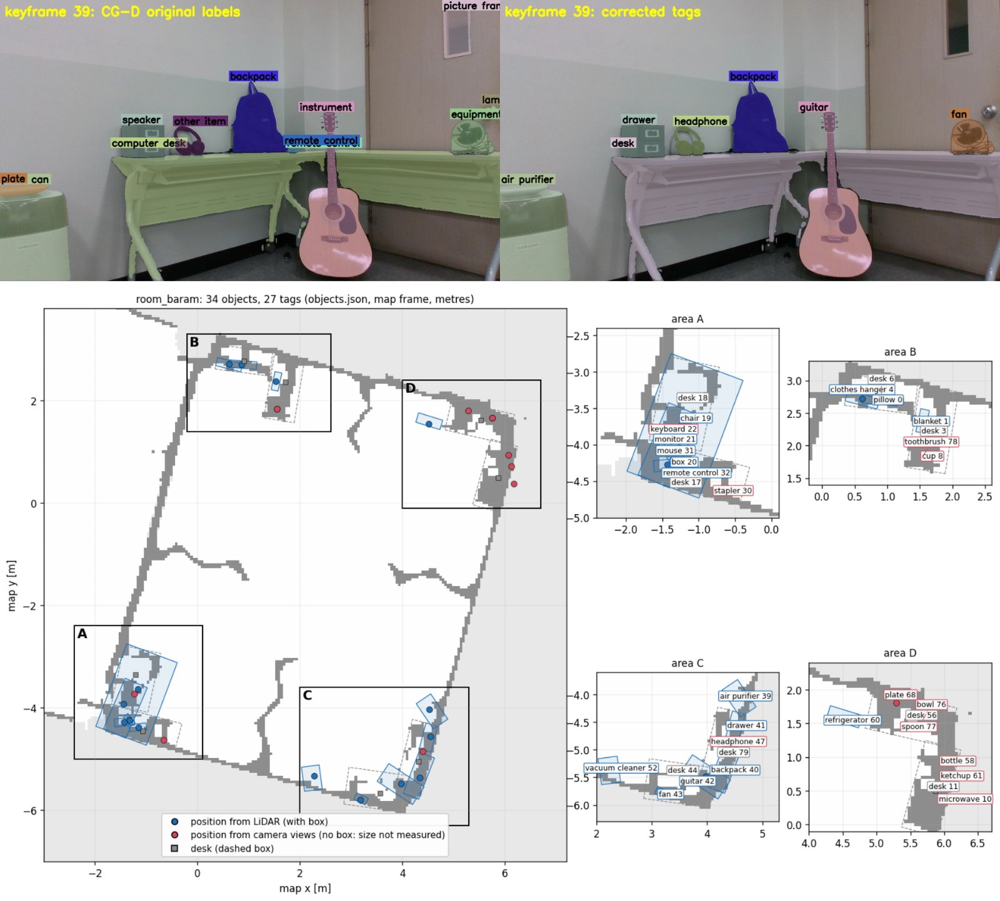
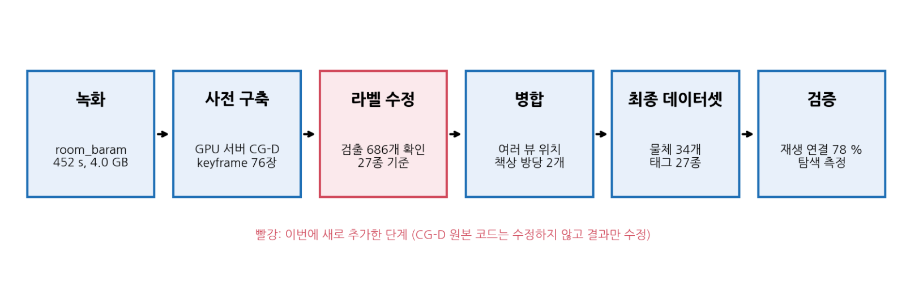
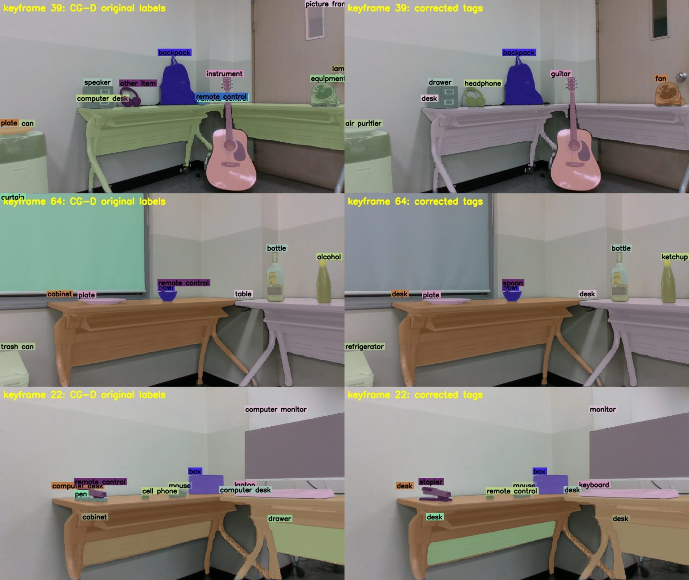
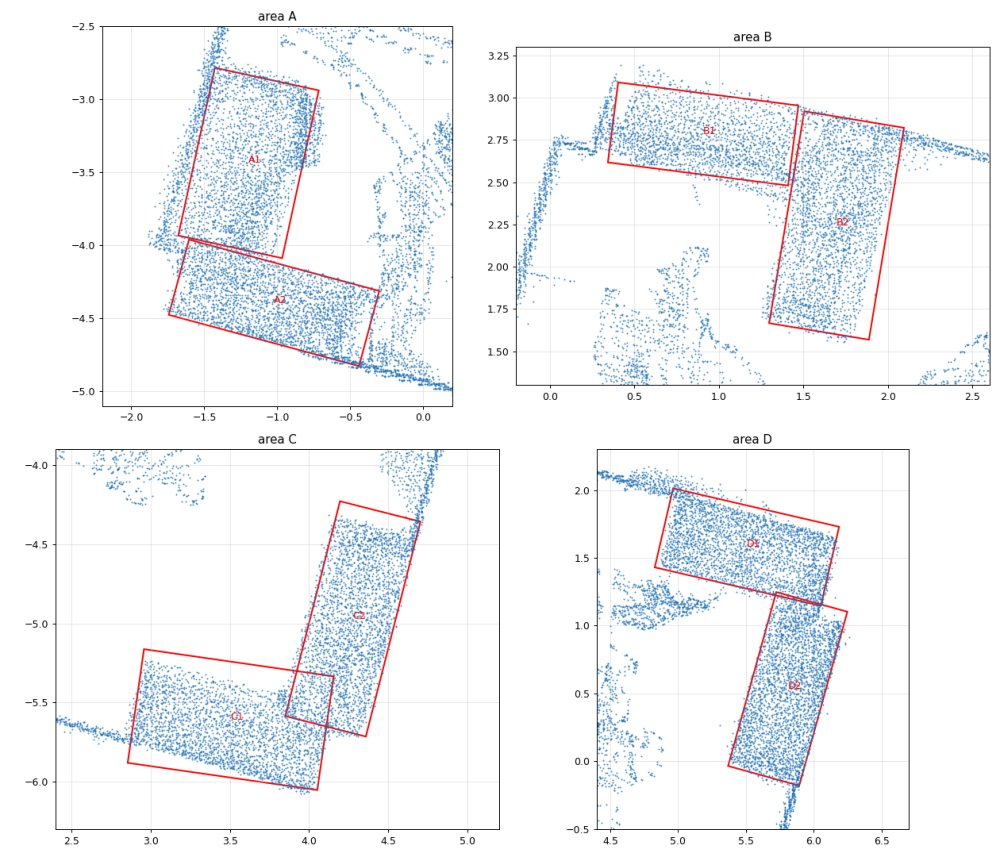
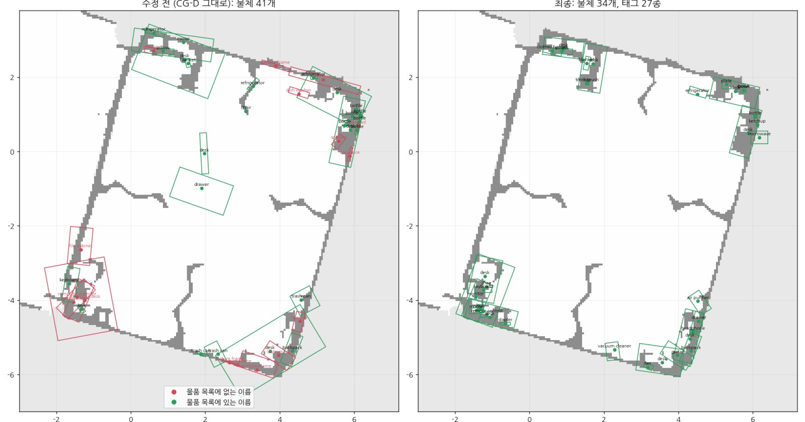

# AtHOME Pre-mapping: 로봇 LiDAR와 Foundation Model로 만드는 Open-Vocabulary 3D 물체 지도

[**Pipeline**](#pipeline) |
[**Foundation Models**](#foundation-models) |
[**Setup**](#setup) |
[**Usage**](#usage) |
[**Results**](#results) |
[**Citation**](#citation)

AtHOME 실내 물체 탐색 로봇의 **사전 구축(pre-mapping) 인지 모듈**입니다. 로봇으로 실내를 한 번 녹화한 rosbag에서, Scene Graph 입력용 물체 지도(`objects.json`)를 만듭니다.
- **의미:** 사진마다 foundation model(RAM → Grounding DINO → SAM → CLIP, [ConceptGraphs](https://github.com/concept-graphs/concept-graphs)의 CG-D 경로)로 얻습니다.
- **3D 위치·형상:** RGB-D depth 대신 로봇의 LiDAR(Livox Mid-360, FAST-LIO)로 얻습니다.



<sub>위: 같은 keyframe에서 CG-D 원래 이름(왼쪽)과 라벨 확인 후 태그(오른쪽). 아래: room_baram 최종 물체 지도 34개(27종). 파랑은 LiDAR 위치, 빨강은 사진 기반 위치.</sub>

# Updates

* **2026-11-26:** GPU PC 한 대에서 bag부터 전달 묶음까지 처리하는 `prebuild.sh`를 추가했고, 저장소를 사전 구축 전용으로 정리했습니다. 라벨 확인 도구(`tools/label_correction`)를 추가했고, 녹화가 위치 지정 뒤에만 시작되도록 고쳤습니다. 실시간 탐색 코드까지 포함한 이전 판은 태그 [`live-search-20261105`](https://github.com/DongGeonYoon/athome/tree/live-search-20261105)에 있습니다.
* **2026-11-05:** room_baram(4개 구역 방) 데이터셋. 라벨 확인으로 물품 27종을 모두 담았습니다(물체 41 → 34개, 같은 물품 중복 13 → 0).
* **2026-11-03:** 406호 데이터셋(run6), 물체 18개
* **2026-10-28:** 412호 데이터셋(run5), 물체 38개. Nav2 지도와 PCD 지도를 묶음에 동봉
* **2026-10-11:** 시뮬레이션 데이터셋 v0.8 (Replica, ProcTHOR, Gazebo 39개 장면, 물체 2,115개)

---

# Pipeline



```
[로봇 PC] robot/scripts/record_premap.sh
   위치추정(FAST_LIO_LOCALIZATION2, PCD 지도) + D435 RGB 1280×720 + Mid-360 → rosbag
        ▼
[GPU PC] robot/scripts/prebuild.sh
   1 robot_bag_extract.py   keyframe 선택(저속·정지 구간, 0.3 m / 5° / 0.5 s), keyframe별 LiDAR(0.5 s 누적), map 자세
   2 run_cgd_sources.sh     CG-D (gsa_fast.py가 CG-D 원본 코드를 그대로 실행, 어휘 v2)
   3 build_dataset.py       2D 검출 → LiDAR 3D 관측 → 물체 연결·융합 → objects.json (+ Nav2 지도를 occupancy로)
   4 전달 묶음               scene_graph_dataset/ + nav2_map/ + pcd_map/ + manifest.json + zip/sha256
        │ (선택) 물품 목록을 아는 장소
        ▼
[GPU/PC] tools/label_correction   prepare.py → build.py → finalize.py
```

물체 하나는 다음 값으로 나타냅니다. 형식은 `semantic_geometry_ws/tools/scene_graph_dataset/objects.schema.json`(v0.8)입니다.
```
F_j = { object_id, semantic_tag, confidence, centroid, bbox_3d(center, size, yaw), clip_feature(1024), num_observations }
      + points/obj_<id>.npy (map 좌표 점구름)
```

---

# Foundation Models

| 단계 | 모델 | 논문 | 쓰는 형태 |
|---|---|---|---|
| 전체 틀 | ConceptGraphs | Gu et al., ICRA 2024 ([arXiv:2309.16650](https://arxiv.org/abs/2309.16650)) | 사진마다 태그 → 검출 → 마스크 → CLIP, 관측을 3D 물체로 연결·융합 |
| 태그 | RAM (Swin-L) | Zhang et al., 2023 ([arXiv:2306.03514](https://arxiv.org/abs/2306.03514)) | 사진의 물체 이름 후보 |
| 검출 | Grounding DINO (SwinT-OGC) | Liu et al., ECCV 2024 ([arXiv:2303.05499](https://arxiv.org/abs/2303.05499)) | 이름 목록으로 상자 검출 (box/text threshold 0.2) |
| 분할 | SAM (ViT-H) | Kirillov et al., ICCV 2023 ([arXiv:2304.02643](https://arxiv.org/abs/2304.02643)) | 상자 → 마스크 |
| 검출+분할 구현 | Grounded-SAM | Ren et al., 2024 ([arXiv:2401.14159](https://arxiv.org/abs/2401.14159)) | Grounding DINO와 SAM을 잇는 공개 구현 |
| 의미 feature | CLIP / OpenCLIP ViT-H-14 (laion2b_s32b_b79k) | Radford et al., ICML 2021; Cherti et al., CVPR 2023 | 마스크 영역 crop → 1024차원 feature |
| 자세·LiDAR | FAST-LIO2 | Xu et al., IEEE T-RO 2022 | map 좌표 자세, body 좌표 점군 |
| 평가 장면 | Replica, ProcTHOR | Straub et al., 2019; Deitke et al., NeurIPS 2022 | 정답(GT)이 있는 시뮬레이션 장면 |

**연결 점수 (ConceptGraphs 방식):** 새 관측 o와 지도 물체 j의 점수는 `φ_sem + φ_geo`이고, 기준값 1.1 이상이면 같은 물체로 봅니다.
- `φ_sem = (cos(CLIP_o, CLIP_j) + 1) / 2`
- `φ_geo`: o의 점 중 j의 점과 5 cm 안에 있는 비율

융합하면 CLIP은 관측 수로 가중 평균하고, 점은 voxel 5 cm로 합치며, 이름은 다수결로 정합니다.

## 원본 방법에서 바꾸거나 더한 것

foundation model과 CG-D 원본 코드는 수정하지 않았습니다(장치 설정 patch 1건만 있음). 아래 변경은 바깥 wrapper(`gsa_fast.py`)와 빌더에서 처리합니다.

| 원본 방식의 문제 | 이 저장소의 처리 | 근거 결과 |
|---|---|---|
| ConceptGraphs는 RGB-D depth로 3D를 만드는데, 로봇 D435는 USB 2.0이라 depth를 쓸 수 없음 | **LiDAR 기하:** 마스크 안에 투영되는 FAST-LIO body 점군(0.5 s 누적), depth gate(MAD 2.5), 관측별 DBSCAN 0.15 m | Gazebo에서 실제 ROS 경로와 오프라인 결과: 90쌍 일치, 중심 거리 중앙값 0.000 m |
| 카메라–LiDAR 정렬 오차로 배경 점이 마스크 가장자리에 섞임 | **실물만 마스크 경계 3 px 축소** | run4 책상 위 작은 물체 중 책상 "위"로 잡힌 수 1/6 → 5/6 |
| 튀는 점 하나가 상자를 키움 | **상자 계산 전 외톨이 점 제거** (k = 8, 2σ, 8 cm 이상) | run4 책상 윗면 0.44 → 0.33 m |
| RAM 태그가 프레임마다 누적되고, 작은 생활용품 이름은 잘 안 나옴 | **어휘 v2:** 프레임별 RAM 태그 − `blocklist.txt` + `household.txt`(46개), 누적 끔 | ProcTHOR 의미 정밀도 0.33 → 0.52, 0.42 → 0.56 |
| Grounding DINO 문구 → 클래스 대응이 실패하면 0번 클래스를 붙임 | **대응 규칙 교체:** 완전 일치 → 포함된 가장 긴 클래스 → 단어 일치 → `other item` | 무작위 이름(`chocolate cake` 등) 제거 |
| CG-D의 연결 기준값 1.2는 위 점수식에서 검증되지 않음 | **GT 30개 장면에서 1.0–1.4 비교, 1.1 채택** | [Results](#results) 표 |
| 한 물체가 두 물체로 남음 (다른 면, 얇은 조각, 동의어) | **내보내기 직전 재병합:** CLIP cos ≥ 0.9 + 공간 공유 + 합친 상자 1.25배 이내 | 실물 run2 쪼개짐 22 → 13쌍, GT 의미 재현율 유지 |
| 문(2 m)에 작은 물체 이름이 붙음 | **크기 사전 검사:** 상자가 이름의 상한 × 1.5를 넘으면 다른 투표 이름으로, 없으면 제외 | 비현실적 이름 제거 |
| 8 GB GPU에서 원본 설정(전부 GPU fp32)이 메모리 부족 | **장치·정밀도 분할:** RAM CPU, SAM·CLIP fp16, Grounding DINO GPU fp32 | 원본과 결과 동일, GPU 최대 5.4 GB |
| 로봇 주행 데이터에는 keyframe·지도 좌표·바닥 높이가 없음 | **로봇 입력 변환:** 저속·정지 구간 keyframe, 위치추정 TF, 바닥 추정, Nav2 지도와 지도 버전(해시) 기록 | 2D 지도와 같은 좌표의 물체 지도 |
| 자동 결과에 목록 밖 이름, 오검출, 같은 물품 중복이 남음 | **(선택) 라벨 확인 단계** ([Usage](#4-optional-label-correction)) | room_baram: 목록 이름 25 → 34개, 중복 13 → 0 |

---

# Setup

### 0. 저장소 배치
스크립트는 아래 경로를 기준으로 동작합니다.
```bash
git clone https://github.com/DongGeonYoon/athome.git ~/athome
ln -s ~/athome/semantic_geometry_ws ~/semantic_geometry_ws
mkdir -p ~/real/results
ln -s ~/athome/robot/scripts ~/real/scripts
ln -s ~/athome/robot/config ~/real/config
```

### 1. Python 환경 (`conceptgraph`)
Python 3.10, PyTorch 2.0.1 + CUDA 11.8에서 시험했습니다.
```bash
conda create -n conceptgraph python=3.10.13 && conda activate conceptgraph
pip install torch==2.0.1 torchvision==0.15.2 --index-url https://download.pytorch.org/whl/cu118
pip install -r ~/athome/setup/requirements.txt
```

### 2. ConceptGraphs와 Grounded-SAM 설치
`~/conceptgraph_ws/` 아래에 아래 commit으로 받습니다.

| 저장소 | commit |
|---|---|
| [concept-graphs](https://github.com/concept-graphs/concept-graphs) | `93277a02bd` + `third_party/concept-graphs_model_utils_device.patch` |
| [Grounded-Segment-Anything](https://github.com/IDEA-Research/Grounded-Segment-Anything) | `a4d76a2b55` |
| [recognize-anything](https://github.com/xinyu1205/recognize-anything) | `7cb804a860` |
| [gradslam](https://github.com/gradslam/gradslam) | `59ca872e3d` |
| [chamferdist](https://github.com/krrish94/chamferdist) | `ee753899b5` |

```bash
C=~/conceptgraph_ws; G=$C/Grounded-Segment-Anything
git -C $C/concept-graphs apply ~/athome/third_party/concept-graphs_model_utils_device.patch   # .to("cuda") -> .to(device)
export CUDA_HOME=$CONDA_PREFIX            # nvcc 11.8 (conda install -c nvidia/label/cuda-11.8.0 cuda-toolkit)
pip install --no-deps -e $C/concept-graphs -e $G/segment_anything -e $G/recognize-anything
pip install --no-deps --no-build-isolation -e $G/GroundingDINO
pip install --no-deps $C/third_party/gradslam
export GSA_PATH=$G
```

### 3. 가중치
```bash
GSA_PATH=~/conceptgraph_ws/Grounded-Segment-Anything bash ~/athome/setup/download_weights.sh
# GroundingDINO SwinT-OGC, SAM ViT-H, RAM Swin-L, MobileSAM, CLIP ViT-H-14 (해시: setup/weights.sha256)
```

### 4. ROS 2 Humble과 위치추정
- **ROS 2 Humble:** bag 추출에만 필요하고, 이 저장소에는 빌드할 ROS 패키지가 없습니다. ROS 단계와 CG-D 단계는 **다른 셸**에서 실행합니다(두 환경의 OpenCV 충돌). `prebuild.sh`가 알아서 나눠 실행합니다.
- **팀 위치추정 워크스페이스 (이 저장소에 없음):** `~/fast_lio_ws`의 `mppi_nav/slam_costmap_bringup.launch.py`(Livox, FAST_LIO_LOCALIZATION2, map_server, RViz)
- **카메라 extrinsic:** `semantic_geometry_ws/config/robot_calibration.yaml` (`T_cam_body`)

---

# Usage

### 1. 녹화 (로봇 PC)
```bash
MAP_PCD=<pcd> MAP_YAML=<nav2 yaml> bash robot/scripts/record_premap.sh premap_A
#  RViz "2D Pose Estimate"로 시작 위치를 지정하면 그때부터 녹화합니다.
#  로봇은 천천히 움직이고 자주 멈춥니다 (keyframe은 정지·저속 구간에서 뽑힘).
bash robot/scripts/record_premap.sh stop
```

### 2. 데이터셋 만들기
**한 번에 (권장):**
```bash
bash robot/scripts/prebuild.sh premap_A        # 녹화 때 쓴 지도(map.env)로 처리
#  → ~/real/results/premap_A/scene_graph/<버전>/ + premap_A_<버전>.zip(.sha256)   (8 GB GPU, keyframe 76장 약 6분)
```

**단계별로:**
```bash
T=~/semantic_geometry_ws/tools; EXP=~/exp_premap; PY=~/miniforge3/envs/conceptgraph/bin/python
# (ROS 셸) bag → keyframe
source /opt/ros/humble/setup.bash
python3 $T/sim_sources/robot_bag_extract.py ~/real/results/premap_A/bag $EXP/robot/sources/premap_A --name premap_A \
  --max-speed 0.5 --max-turn 0.6 --kf-dist 0.3 --kf-yaw 5 --kf-gap 0.5
# (새 셸) CG-D → 데이터셋
bash $T/sim_sources/run_cgd_sources.sh $EXP/robot/sources v2
(cd $T/scene_graph_dataset && $PY build_dataset.py --exp $EXP --sources robot --out-name sg --occupancy-map <nav2 yaml>)
#  → $EXP/sg/scenes/robot_premap_A/objects.json   (8 GB GPU, keyframe 47장 약 4분)
```

| 결과 | 내용 |
|---|---|
| `scene_graph_dataset/` | `index.json`, `schema/`, `scenes/robot_<이름>/` (`objects.json`, `objects_all.json`, `points/`, `occupancy/`, `metadata.json`) |
| `nav2_map/`, `pcd_map/` | 사용한 2D 지도와 위치추정 PCD, 각 `SHA256SUMS` |
| `manifest.json` | 이름, 버전, 물체 수, 지도 버전 `"sha256:" + sha256(yaml + 이미지)` 앞 16자리 |

- `objects.json`은 관측 2회 이상이고 일반 태그(`other item` 등)가 아닌 물체만 담습니다. `objects_all.json`은 필터 전 전체입니다.

### 3. 시뮬레이션 데이터셋
같은 빌더로 `--sources replica|replica_full|procthor|gazebo`를 지정합니다.
- **Replica:** 렌더링부터 할 수 있습니다.
- **Gazebo:** bag 추출부터 할 수 있습니다(`gazebo_extract.py`, Livox 메시지가 있는 `fast_lio_ws` 필요).
- **ProcTHOR, Replica 전체판:** 수집해 둔 원천 데이터가 필요합니다(수집 도구는 태그 `full-20261028`).
```bash
(cd $T/replica_rig && $PY render_rig.py --scene room0 --out ~/exp_sim)
bash $T/sim_sources/run_cgd_sources.sh ~/exp_sim/replica_rig v2
(cd $T/scene_graph_dataset && $PY build_dataset.py --exp ~/exp_sim --sources replica --out-name sg)
```

### 4. (Optional) Label Correction
방에 놓인 물품 목록을 아는 경우, 사람이 검출 단위로 태그를 정하고 나머지를 다시 만듭니다. foundation model과 빌더 코드는 그대로이고, 결정과 설정 파일만 방마다 다릅니다. 예시: `tools/label_correction/configs/room_baram_labels.txt`, `room_baram.yaml`

```bash
L=$T/label_correction; SRC=$EXP/robot/sources/<이름>
$PY $L/prepare.py $SRC labels.txt --exclude-keyframes 0
$PY $L/build.py --exp $EXP --occupancy-map <nav2 yaml> --single-view-tags cup,headphone,plate --trace trace.json
$PY $L/finalize.py room.yaml $SRC labels.txt $EXP/sg_labeled out_dataset --trace trace.json --keyframe-json kf/ --figures fig/
```

| 단계 | 내용 |
|---|---|
| `labels.txt` | keyframe마다 `<keyframe>: <검출 id>=<태그> ...`. 적지 않은 검출은 제거 |
| `prepare.py` | 태그를 바꾼 검출 사본을 만듭니다. 제외 keyframe(예: 위치 지정 전 사진)은 검출과 LiDAR 지도 점을 모두 뺍니다 |
| `build.py` | 같은 태그끼리만 연결하고, 지정 태그는 관측 1회도 내보냅니다. `--trace`: 물체마다 쓰인 keyframe 검출 기록 |
| `finalize.py` | **단일 물품:** 여러 뷰의 마스크 아래쪽 시선을 받침면(책상 면, 바닥)과 교차해 위치를 정하고, 여러 뷰가 동의한 LiDAR 점을 씁니다. LiDAR 점이 없으면 위치만 정하고 크기는 미측정으로 표시합니다(`views_only`). **개수를 아는 가구:** 책상 높이 LiDAR 단면에 사각형을 맞춥니다 |

같은 입력으로 다시 실행하면 room_baram 최종 데이터셋의 45개 물체가 모두 일치합니다(위치·크기 1 mm, CLIP cos 0.9999 이내).

<p align="center">
 
</p>
<sub>왼쪽: keyframe 39 / 64 / 22의 CG-D 원래 이름과 수정 태그. 오른쪽: 책상 높이 LiDAR 단면에 맞춘 책상 8개(방마다 2개).</sub>

---

# Results

### 시뮬레이션 데이터셋 v0.8 (39개 장면, 물체 2,115개)
로봇 rig 조건(카메라 0.77 m, Mid-360 0.445 m, 실제 calibration)으로 재현했습니다. GT 중심과 물체 상자 중심의 XY 거리 0.6 m 이내를 매칭으로 봅니다.

| 소스 | 장면 | keyframe | 물체 | 기하 정밀도 | 의미 정밀도* | 기하 재현율 | 의미 재현율 |
|---|---|---|---|---|---|---|---|
| Replica (NICE-SLAM) | 8 | 2,712 | 329 | – | – | – | – |
| Replica 전체판 | 10 | 525 | 562 | 0.94 | 0.48 | 0.81 | 0.30 |
| ProcTHOR-10k | 20 | 1,194 | 1,118 | 0.83 | 0.60 | 0.77 | 0.37 |
| Gazebo (실제 ROS 경로) | 1 | 108 | 106 | 0.68 | 0.43 | 0.86 | 0.55 |

\* 문·창문·커튼 제외. 기하는 안정적이고, 의미 재현율을 낮추는 주원인은 CG-D 검출 단계입니다(ProcTHOR: 큰 물체 79개 보임 → 67 검출 → 65 기하 확보).

<details>
<summary>연결 기준값과 어휘 비교</summary>

| 연결 기준값 | 의미 재현율 (ProcTHOR / Replica 전체판) | 같은 태그 중복 | 판단 |
|---|---|---|---|
| 1.0 | 0.387 / 0.300 | 7 / 13 | 과병합 |
| **1.1** | **0.376 / 0.305** | **9 / 15** | 채택 |
| 1.2 | 0.364 / 0.300 | 11 / 16 | |
| 1.4 | 0.338 / 0.271 | 23 / 29 | 쪼개짐 |

| 어휘 (ProcTHOR 2개 집) | 의미 정밀도 | 의미 재현율 | 작은 물체 재현율 |
|---|---|---|---|
| 원본 (RAM 태그 누적) | 0.33 / 0.42 | 0.17 / 0.31 | 0.01 / 0.03 |
| v1: 누적 끔 | 0.51 / 0.49 | 0.14 / 0.18 | 0.00 / 0.03 |
| **v2: + blocklist + household** | **0.52 / 0.56** | **0.19 / 0.31** | **0.01 / 0.10** |
| v3: v2 + 누적 | 0.42 / 0.50 | 0.21 / 0.34 | 0.04 / 0.08 |
</details>

### 실물 로봇 데이터셋
D435 컬러 1280×720(fx 903.47, 수평 시야 70.6°, depth 없음). 카메라–LiDAR 시각 차이는 최대 0.05~0.07 s입니다.

| 녹화 | 장소 | 길이 | keyframe | 처리 단계 | 최종 물체 |
|---|---|---|---|---|---|
| run5 (10-28) | 412호 | – | 47 | 관측 444 → 물체 66 | **38** |
| run6 (11-03) | 406호 | 343 s | 51 | 검출 335 → 관측 273 → 물체 42 | **18** |
| room_baram (11-05) | 4개 구역 방 | 452 s | 76 | 검출 686 → 라벨 확인 505 → 관측 374 | **34** (27종) |

- **자동 이름 정확도 (run6, 사진 확인 14개):** 9개(64 %). 도마 → `book`, 책상 일부 → `drawer`·`table`·`chair`, 화이트보드 → `computer monitor`
- **room_baram 라벨 확인 전후:**

  | | 자동 | 라벨 확인 후 |
  |---|---|---|
  | 물체 수 | 41 | 34 (책상 8 + 26종 각 1개) |
  | 목록에 있는 이름 | 25 | 34 |
  | 같은 물품 중복 (책상 제외) | 13 | 0 |
  | 태그 종류 (27종 중) | 12 | 27 |

  위치 출처는 LiDAR 15개, LiDAR 단면 책상 8개, 사진 기반 11개(크기 미측정, 뷰 간 차이 0.14~0.23 m)입니다. 그릇·수저·칫솔은 0.445 m 높이 LiDAR 점이 0개였습니다.


<sub>room_baram 자동 결과(왼쪽, 빨강은 목록 밖 이름)와 라벨 확인 후(오른쪽).</sub>

### 처리 시간 (CG-D, 사진 1280×720 한 장, RTX 4060 Laptop 8 GB)

| RAM (CPU) | Grounding DINO | SAM | CLIP | 합계 | GPU 메모리 최대 |
|---|---|---|---|---|---|
| 1.52 s | 0.33 s | 0.77 s | 0.66 s | 약 3.3 s | 5.4 GB |

### (부록) 사전 지도 사진에서의 검출 성능
멈춘 위치의 사진에서 기준 물체가 같은 이름으로 검출되는 비율입니다(신뢰도 0.25, 목표 이름 0.4).

| 장소 | 목표 이름 없음 | 목표 이름 추가 | 거리별 |
|---|---|---|---|
| 412호 | 0.55 | 0.52 | 1.5 m 안 0.84 |
| 406호 | 0.75 | 0.67 | 1.5 m 안 0.88, 1.5~3 m 0.31 |
| room_baram | 0.47 | 0.49 (목표 27종) | 사진 기반 위치 물품은 판정 오차 포함 |

놓친 물체는 같은 자리에서 다시 볼 때(재검출 0.07~0.13)보다 다른 자리에서 볼 때(0.32~0.50) 더 잘 검출되었습니다.

### 한계
1. **의미 정확도:** 자동 결과의 이름 오류는 CG-D 검출 단계에서 생깁니다. 라벨 확인으로 보완한 결과에는 사람의 판단이 들어갑니다.
2. **작은 물체의 3D:** LiDAR(0.445 m)로는 책상 위 작은 물체에 점이 거의 없습니다. 카메라 depth 녹화(USB 3.0, `CAMERA=realsense`)로 나아질 수 있습니다.
3. **상자 크기:** 앞면 위주로 보여 짧은 변이 작고, 주변 점이 섞인 큰 상자가 남습니다(room_baram 의자 1.72 m).
4. **위치 실측:** 실물 데이터셋의 물체 위치는 현장 실측과 비교하지 않았습니다.

---

# Repository Structure

```
semantic_geometry_ws/
  config/robot_calibration.yaml        카메라 extrinsic (T_cam_body)
  src/semantic_geometry_fusion/        fusion 라이브러리 (geometry, association, feature_fusion, scene_graph_export)
  tools/
    sim_sources/                       robot_bag_extract.py, gazebo_extract.py, run_cgd_sources.sh
    replica_rig/                       gsa_fast.py (CG-D wrapper), vocab/ (어휘 v2), Replica 렌더링·공용 상수
    replica_feasibility/plyload.py
    scene_graph_dataset/               build_dataset.py, objects.schema.json
    label_correction/                  prepare.py, build.py, finalize.py, common.py, configs/
robot/scripts                          record_premap.sh (녹화), prebuild.sh (bag → 데이터셋 묶음), 위치추정·카메라 실행, V4L2 카메라 노드
robot/config                           calibration, py_shim (위치추정 import 우회)
setup/                                 requirements.txt, download_weights.sh, weights.sha256
third_party/                           CG-D patch 1건
assets/                                README 그림
```

---

# Citation

이 저장소는 아래 연구의 공개 코드와 모델을 사용합니다.

```bibtex
@inproceedings{conceptgraphs,
  title     = {ConceptGraphs: Open-Vocabulary 3D Scene Graphs for Perception and Planning},
  author    = {Gu, Qiao and Kuwajerwala, Ali and Morin, Sacha and Jatavallabhula, Krishna Murthy and others},
  booktitle = {IEEE International Conference on Robotics and Automation (ICRA)},
  year      = {2024}
}
@article{ram,
  title   = {Recognize Anything: A Strong Image Tagging Model},
  author  = {Zhang, Youcai and Huang, Xinyu and Ma, Jinyu and others},
  journal = {arXiv preprint arXiv:2306.03514},
  year    = {2023}
}
@inproceedings{groundingdino,
  title     = {Grounding DINO: Marrying DINO with Grounded Pre-Training for Open-Set Object Detection},
  author    = {Liu, Shilong and Zeng, Zhaoyang and Ren, Tianhe and others},
  booktitle = {European Conference on Computer Vision (ECCV)},
  year      = {2024}
}
@inproceedings{sam,
  title     = {Segment Anything},
  author    = {Kirillov, Alexander and Mintun, Eric and Ravi, Nikhila and others},
  booktitle = {IEEE/CVF International Conference on Computer Vision (ICCV)},
  year      = {2023}
}
@article{groundedsam,
  title   = {Grounded SAM: Assembling Open-World Models for Diverse Visual Tasks},
  author  = {Ren, Tianhe and Liu, Shilong and Zeng, Ailing and others},
  journal = {arXiv preprint arXiv:2401.14159},
  year    = {2024}
}
@inproceedings{clip,
  title     = {Learning Transferable Visual Models From Natural Language Supervision},
  author    = {Radford, Alec and Kim, Jong Wook and Hallacy, Chris and others},
  booktitle = {International Conference on Machine Learning (ICML)},
  year      = {2021}
}
@inproceedings{openclip,
  title     = {Reproducible Scaling Laws for Contrastive Language-Image Learning},
  author    = {Cherti, Mehdi and Beaumont, Romain and Wightman, Ross and others},
  booktitle = {IEEE/CVF Conference on Computer Vision and Pattern Recognition (CVPR)},
  year      = {2023}
}
@article{fastlio2,
  title   = {FAST-LIO2: Fast Direct LiDAR-Inertial Odometry},
  author  = {Xu, Wei and Cai, Yixi and He, Dongjiao and Lin, Jiarong and Zhang, Fu},
  journal = {IEEE Transactions on Robotics},
  year    = {2022}
}
@article{replica,
  title   = {The Replica Dataset: A Digital Replica of Indoor Spaces},
  author  = {Straub, Julian and Whelan, Thomas and Ma, Lingni and others},
  journal = {arXiv preprint arXiv:1906.05797},
  year    = {2019}
}
@inproceedings{procthor,
  title     = {ProcTHOR: Large-Scale Embodied AI Using Procedural Generation},
  author    = {Deitke, Matt and VanderBilt, Eli and Herrasti, Alvaro and others},
  booktitle = {Advances in Neural Information Processing Systems (NeurIPS)},
  year      = {2022}
}
```

# Acknowledgement

[ConceptGraphs](https://github.com/concept-graphs/concept-graphs), [Grounded-Segment-Anything](https://github.com/IDEA-Research/Grounded-Segment-Anything), [Recognize Anything](https://github.com/xinyu1205/recognize-anything), [OpenCLIP](https://github.com/mlfoundations/open_clip), [FAST-LIO](https://github.com/hku-mars/FAST_LIO), [gradslam](https://github.com/gradslam/gradslam)의 공개 코드를 바탕으로 만들었습니다.

# License

MIT (`LICENSE`). 외부 코드와 모델 가중치는 각 저장소의 라이선스를 따릅니다.
